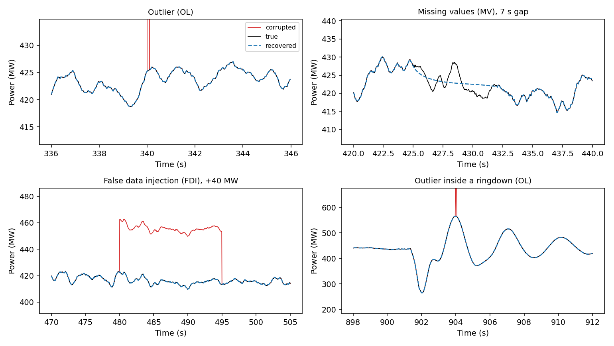

# PMU-Data-Classification

Rule-based and Random Forest classification of PMU data for power system oscillation monitoring.

Mid-term project, Department of Electrical Engineering, NIT Rourkela
Supervisor: Prof. Shekha Rai
Authors: MD Mizgan Ali (123EE0257), Sameer Shaik (123EE0047)

Every one-second segment of a PMU power measurement (30 samples/s) gets an
**operational state** and, if degraded, a **data-integrity** class.

| Operational state | Meaning |
|---|---|
| NA | normal ambient |
| NR | normal ringdown |
| DA | degraded ambient |
| DR | degraded ringdown |

Integrity classes: **MV** (missing or stuck values), **OL** (outliers), **FDI** (false data injection, constant offset).

## Two classifiers
**Rule-based** (`layer1_classifier.py`, `layer2_integrity.py`)
- Ringdowns: median filter, 0.2-2 Hz band-pass, STA/LTA energy ratio (2 s / 120 s); start r > 5 and STA > 3 MW, end r <= 4 (max 40 s), at least 6 zero crossings.
- Integrity: MV (NaN or >= 8 identical samples), OL (spike above max(7 sigma, 3 MW)), FDI (step up then step down within 120 s, threshold 5 sigma_S). Priority MV > FDI > OL.

**Random Forest** (`rf_classifier.py`)
- 300 trees, 70 features per segment (16 base features plus 9 of them at shifts of +-1, +-2, +-4 s), balanced_subsample class weights.
- Forest A predicts the state (NA/NR/DA/DR), forest B the integrity type. Trained on random fault-injection scenarios (t < 1850 s), tested on t >= 1950 s.

`compare_rf_vs_rules.py` compares the two on the same hold-out scenarios; `rf_on_rules_faults.py` runs the Random Forest on the 17 hand-placed faults.

## Results (five random hold-out scenarios, 252 faults, 9205 segments)
| | Rule-based | Random Forest |
|---|---|---|
| State accuracy | 92.3 % | 98.3 % |
| False-alarm segments | 333 | 4 |
| DR recall | 43.7 % | 41.4 % |

On the real record (clean) the two agree on 99.9 % of segments. Faults are injected
into a copy of the record for validation. Details: `report/midterm_report.pdf`.

## Usage
```bash
pip install -r requirements.txt
# put the record in data/data.csv (time_s, power_MW)
python layer1_classifier.py --data data/data.csv
python layer2_integrity.py  --data data/data.csv
python rf_classifier.py     --data data/data.csv
python compare_rf_vs_rules.py --data data/data.csv
```
Output CSVs and PNGs are written to the folder you run from. Sample outputs are in `results/`.

## Planned
Recovery of degraded data, mode estimation (TLS-ESPRIT), stability assessment.

## Data
The PMU record was provided by the supervisor and is included in `data/data.csv`.

cat >> README.md <<'E'

## Recovery of degraded data
`recovery.py` repairs the samples flagged by the classifier, one method per fault type:

| Fault | Method |
|---|---|
| OL (outliers) | cubic-spline interpolation over the spike |
| FDI (offset) | find the up/down steps, estimate the offset, subtract it |
| MV (missing, zeros, stuck) | spline for gaps up to 0.5 s; autoregressive (AR) model predicting from both sides, blended, for longer gaps |

Only flagged samples are changed. Evaluation (`recovery_eval.py`): five random fault-injection
scenarios, RMSE in MW against the true signal (lower is better):

| Fault | Where | Straight-line fill | Proposed |
|---|---|---|---|
| OL | ambient | 0.19 | 0.21 |
| MV, 0.5-3 s | ambient | 5.29 | 3.65 |
| MV, over 3 s | ambient | 4.17 | 3.00 |
| MV, 0.5-3 s | ringdown | 25.05 | 6.68 |
| MV, over 3 s | ringdown | 52.53 | 12.34 |
| FDI | ambient | 12.02 | 12.02 |
| All faults | all | 12.59 | 11.51 |

Clean samples change by only 0.1 MW RMSE. Limits: a gap of several seconds in ambient data
cannot be recovered exactly (the fill is a smooth bridge), and offsets or outliers that the
classifier misses, especially inside ringdowns, stay uncorrected.



```bash
python3 recovery.py --data data/data.csv        # 17 hand-placed faults
python3 recovery_eval.py --data data/data.csv   # random scenarios, writes recovery_results.csv
python3 plot_recovery.py                        # example figure
```
E
